<p align="center">
  
</p>

# Expense Planner

A personal cash-flow planner for Android, built with React Native. It shows how much money is
available before the next payday, records past, present and future movements, and warns ahead of
time when a planned expense would leave an account below zero.

Everything is stored in a local SQLite database on the phone. Nothing leaves the device, except
the update check against this repository's GitHub Releases.

<p align="center">
  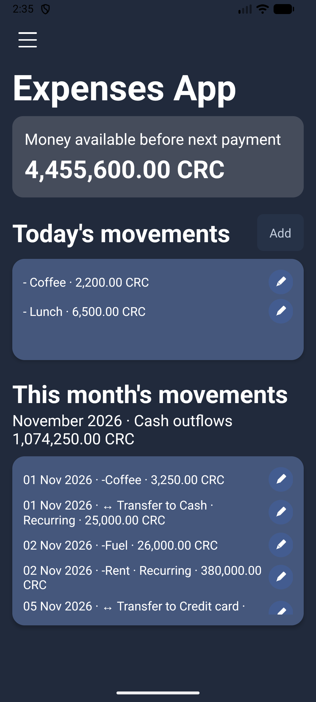
  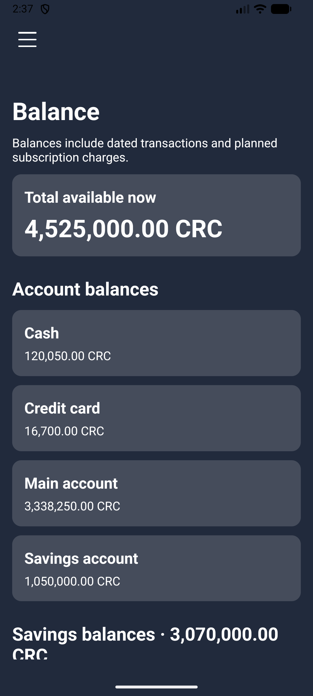
  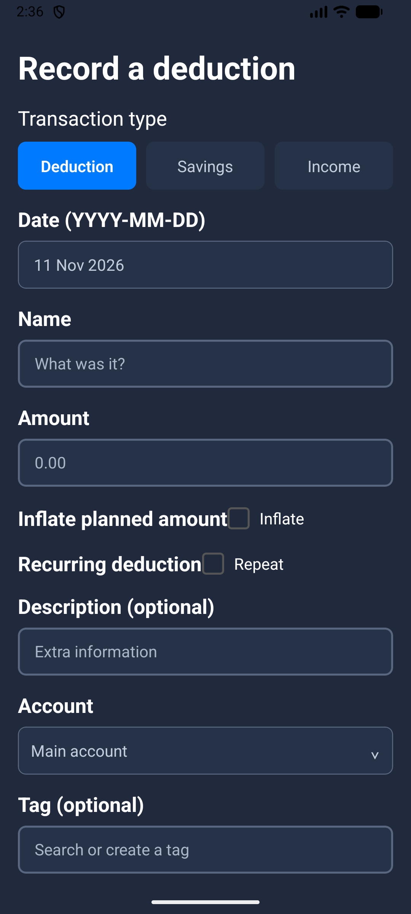
</p>

## Features

- **Planning ahead:** balances are projected up to two years ahead, and the app warns before saving an
  expense that would make an account go negative in the next six months.
- **Income:** a fixed salary with its pay schedule (every 15 days, last day, a specific day or the
  pre-last available day of the month), or variable income recorded as it arrives.
- **Deductions:** Costa Rica's Hacienda income-tax brackets and CCSS, editable from Settings.
- **Accounts:** bank, cash and credit card accounts, with transfers and credit card cut-off and
  payment dates.
- **Movements:** one-off and recurring movements, tags, subscriptions, and optional "inflated"
  amounts that plan with a safety margin.
- **Savings:** savings groups and goals, with a record of how saved money was spent.
- **Your data:** JSON backup and restore with confirmation, and a factory reset in Settings.
- **Interface:** light, dark or system appearance, in English or Spanish.
- **Automatic updates:** new versions are downloaded from GitHub Releases and installed after you
  confirm.

<details>
<summary>More screenshots</summary>

| | | |
|---|---|---|
| 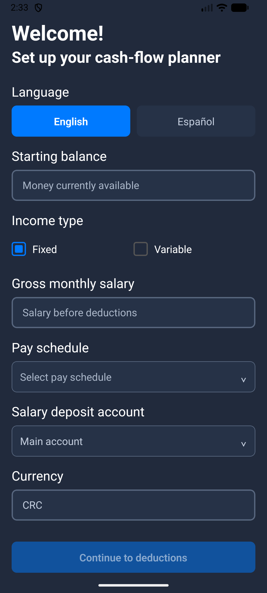 | 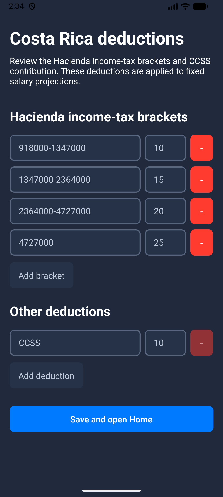 | 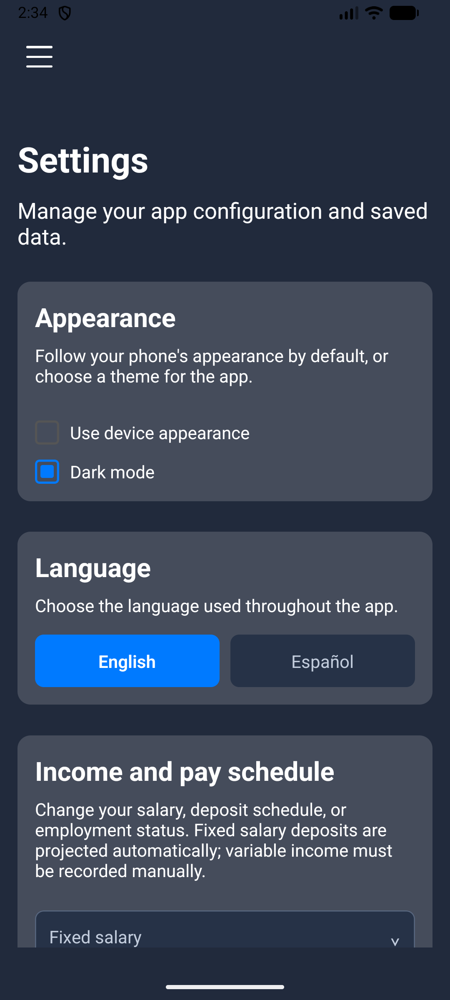 |
| 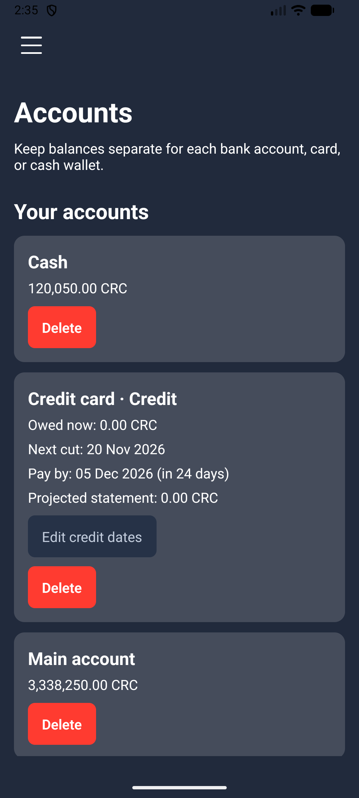 | 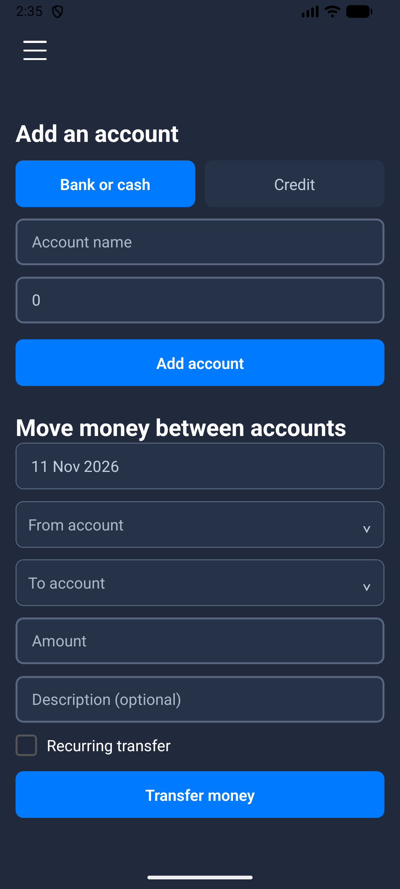 | 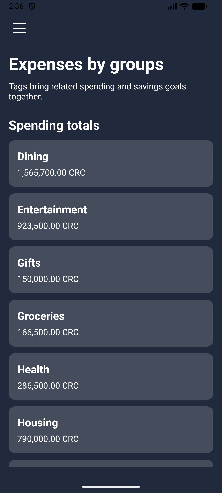 |
| 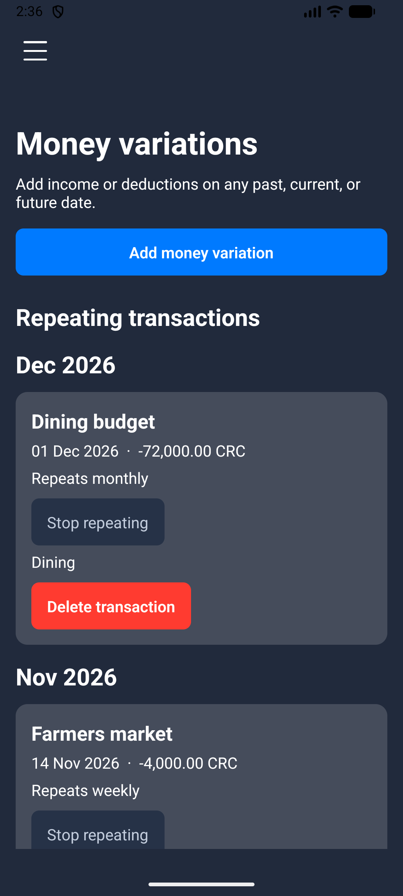 | 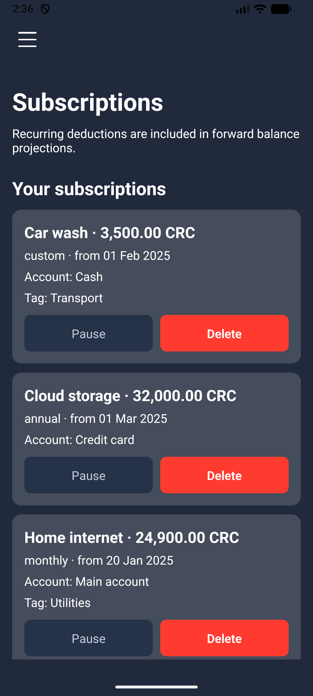 | 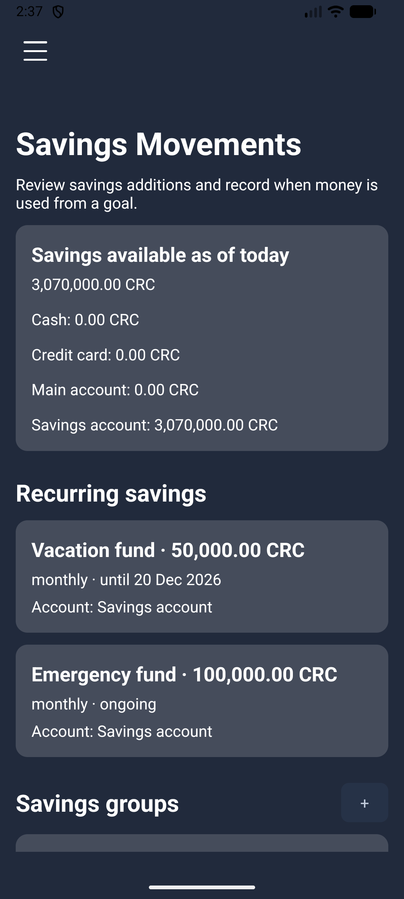 |

</details>

All screenshots use mock data.

## Install

Download the latest `expense-planner-<version>.apk` from
[Releases](https://github.com/dansecan25/ExpensePlannerApp/releases) and open it on your phone.
Android asks you to allow installs from that app the first time.

Later versions install over it and keep your data, because every release is signed with the same
key.

## In-app updates

- At startup, and when the app comes back to the foreground (at most every 12 hours), it checks
  the latest **published** release. Drafts and pre-releases are ignored.
- When a newer version has an APK, a banner offers to download it. The download is checked against
  the size and SHA-256 digest that GitHub reports, then Android's installer asks for confirmation.
- **Settings → App updates** shows the installed version and lets you check right away or open the
  releases page.
- Checks are silent when offline. Only Android builds with the native updater module can update
  themselves.

## Development

The React Native project is in [`expensesapp/`](expensesapp). You need the
[React Native environment](https://reactnative.dev/docs/set-up-your-environment) for Android.

```sh
cd expensesapp
npm install
npm start            # Metro
npm run android      # build and install a debug build on a device or emulator
npm test             # Jest
npm run lint         # ESLint
```

| Folder | Contents |
|---|---|
| `src/views/` | Screens |
| `src/components/` | Shared in-house components (buttons, text, dropdowns, date picker, update banner) |
| `src/utils/` | Shared helpers, stores, the database connector and the updater |
| `src/constants/` | Fixed values, such as the release URLs and the update check interval |
| `src/i18n/` | English and Spanish text |
| `android/app/src/main/java/com/expensesapp/updates/` | Native module that installs downloaded APKs |
| `scripts/` | Development scripts, such as the icon generator |

### App icon

The icons are drawn by [`expensesapp/scripts/generate_app_icons.py`](expensesapp/scripts/generate_app_icons.py)
in the app's colors. It writes the Android adaptive icon (including the themed monochrome layer),
the legacy and round icons, the iOS icon set and `documentationScreenshots/app-icon.png`. To change
the icon, edit the script and run it again:

```sh
cd expensesapp
python3 scripts/generate_app_icons.py   # needs Pillow: pip install pillow
```

## Releases

Releases are built by [`.github/workflows/release.yml`](.github/workflows/release.yml).

### One-time setup: the signing key

Android only installs an update over an app signed with the same key, so every release must use the
same private keystore. Release builds refuse to fall back to the debug key.

1. Create the keystore once, and keep it and its passwords somewhere safe outside the repository. If
   it is lost, installed copies can't be updated any more.

   ```sh
   keytool -genkeypair -v -keystore <path-to>/expense-planner-release.jks \
     -alias <key-alias> -keyalg RSA -keysize 4096 -validity 10000
   ```

2. For local release builds, add these to `~/.gradle/gradle.properties` (never to the repository):

   ```properties
   EXPENSES_UPLOAD_STORE_FILE=<path-to>/expense-planner-release.jks
   EXPENSES_UPLOAD_KEY_ALIAS=<key-alias>
   EXPENSES_UPLOAD_STORE_PASSWORD=<store-password>
   EXPENSES_UPLOAD_KEY_PASSWORD=<key-password>
   ```

3. For CI, add these repository secrets in **Settings → Secrets and variables → Actions**:

   | Secret | Value |
   |---|---|
   | `EXPENSES_KEYSTORE_BASE64` | The keystore file, base64-encoded: `base64 -w0 <path-to>/expense-planner-release.jks` |
   | `EXPENSES_UPLOAD_KEY_ALIAS` | The key alias |
   | `EXPENSES_UPLOAD_STORE_PASSWORD` | The keystore password |
   | `EXPENSES_UPLOAD_KEY_PASSWORD` | The key password |

### Publishing a version

1. Raise `versionCode` by one and set `versionName` in
   [`expensesapp/android/app/build.gradle`](expensesapp/android/app/build.gradle).
2. Commit, then tag that commit with the same version and push the tag:

   ```sh
   git tag v1.0.1
   git push origin v1.0.1
   ```

3. The workflow checks that the tag matches `versionName`, builds the signed APK, and attaches
   `expense-planner-<version>.apk` to a **draft** release.
4. Review the draft, write the release notes and publish it. Phones only see the update once it is
   published.

To rebuild an existing tag, open the **Release** workflow on the Actions tab, choose
**Run workflow** and enter the tag.

To build a signed APK locally instead (with the keystore settings from step 2):

```sh
cd expensesapp/android
./gradlew assembleRelease   # output: app/build/outputs/apk/release/app-release.apk
```
